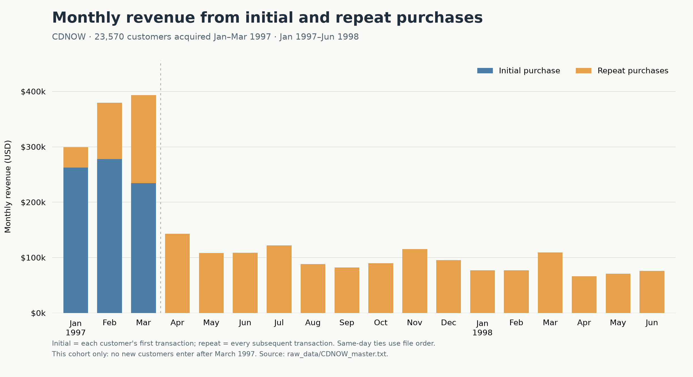
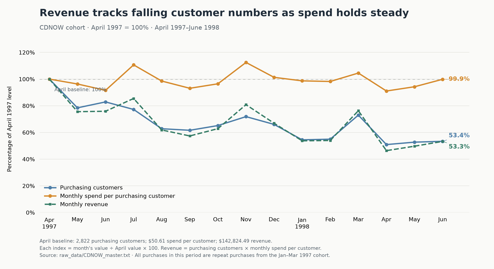
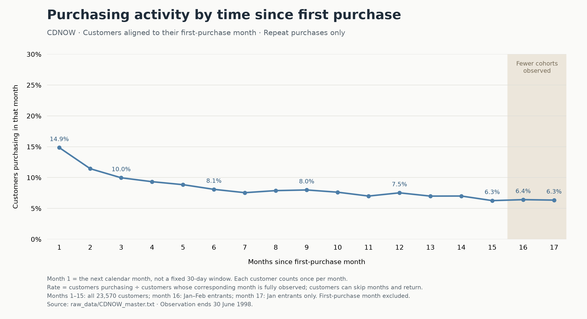
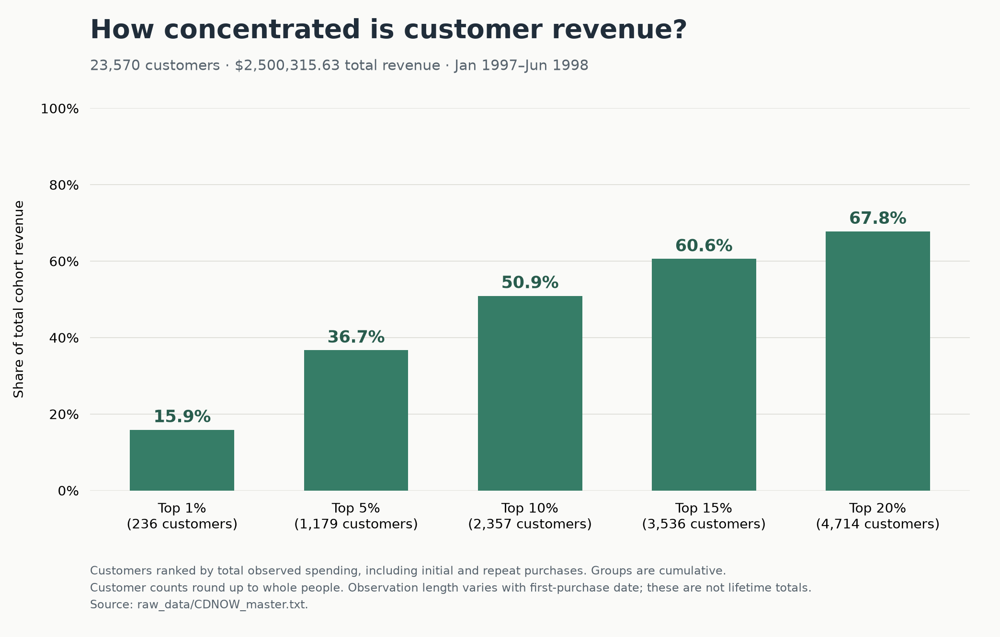
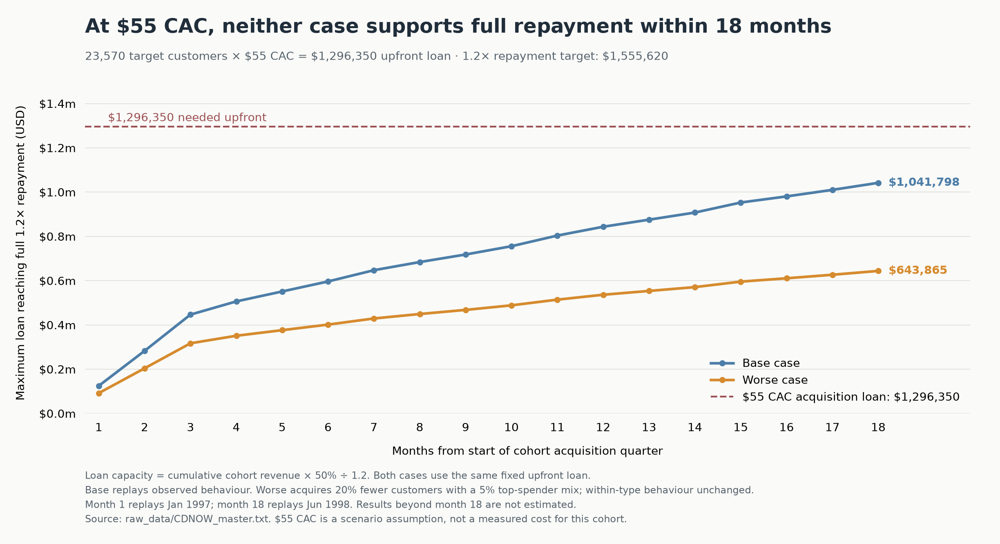

# CDnow investment thought process

## 1. Start with the investment terms

CDnow sells music CDs online and sends them to customers. They want a loan to acquire a future cohort of customers.

A cohort is a group of customers who make their first purchase during the same quarter. For example, the cohort could include all first-time customers in 1997Q2.

The terms are:

- We provide a fixed loan upfront.
- CDnow uses the money for marketing, advertising, and distribution costs.
- CDnow pays us 50% of that cohort's revenue.
- Payments stop when we receive 1.2× the original loan.

We have data for only 1 cohort. It contains 23,570 customers who first purchased in 1997Q1. We can track their purchases until June 1998.

For now, we simplify the problem with the information we have. We exclude other operating costs from this calculation.

The investment question comes down to whether CDnow can repeat the campaign and reach similar revenue targets. We also need to know how much capital they need to do so.

To answer this, we first need to understand how the customers produce revenue.

## 2. Repeat purchases produce most of the revenue

First, split each month's revenue into initial and repeat purchases.

Repeat purchases produce **69.0% of this cohort's total observed revenue**.

From April 1997, all revenue comes from repeat purchases. This follows from the cohort definition: all customers made their first purchase by March.

This makes repeat purchasing important. But monthly revenue falls over time. We need to find out what causes the decline.

## 3. Fewer customers buy, while spend per customer stays stable

Monthly revenue has 2 parts:

**Monthly revenue = purchasing customers × average monthly spend per purchasing customer**

Put all 3 measures on the same scale. Set April 1997 to 100% for each measure.

The revenue line follows the customer line closely. Average monthly spend per purchasing customer stays near its April level.

By June 1998, purchasing customers fall to **53.4%** of the April level. Revenue falls to **53.3%**, while spend per purchasing customer stays at **99.9%**.

So, the decline mainly comes from fewer customers buying each month.

Customers first purchased at different times. We therefore align them by their first purchase month to see how activity changes as time passes.

**14.9% of customers buy in month 1, compared with 6.3% in month 17.** The overall trend declines, with some monthly increases.

Here, month 1 means the next calendar month after the first purchase month. Each customer counts once in each month when they buy. Customers can skip months and return.

Month 17 includes only January entrants. All 23,570 customers are observed through month 15, when the rate is also **6.3%**.

This raises a second issue. If fewer customers return, how much revenue depends on the customers who spend the most?

## 4. A small group produces a large share of revenue

Rank all customers by their total observed spending. Then calculate the revenue share of each top group.

**The top 10% of all customers account for 50.9% of total observed revenue.** This includes initial and repeat purchases.

So, customer numbers are not the only measure. We also need to consider whether CDnow can acquire customers who spend in a similar way.

These are the top spenders identified after observing their purchases. The data does not show how to identify them before acquisition.

## 5. Conclusions so far

Before moving on, I will consolidate the conclusions here:

1. This cohort is very dependent on repeat purchases, and customers do come back. But the percentage purchasing each month declines over time. We see 14.9% repurchase in month 1, compared with 6.3% in month 15. All customers are observed through month 15.
2. The number of customers is not the only metric. The top 10% of all customers account for 50.9% of total observed revenue, including initial and repeat purchases. This means we need to know if CDnow can repeat their ability to attract customers with similar spending behaviour.

Since the data available is only for 1 cohort, we cannot yet tell if CDnow can repeat these results. We therefore need to test what happens if they acquire fewer customers and fewer high spenders.

## 6. Test base and worse case scenarios

Assuming we do want to invest, we need to estimate when we can receive the full repayment.

Use 2 scenarios:

| Assumption | Base case | Worse case |
|---|---|---|
| Customers acquired | 23,570 | 18,856: a 20% drop |
| Share behaving like historical top spenders | 10% | 5% |
| Share behaving like other historical customers | 90% | 95% |
| Spending and purchase timing within each group | Same as the data | Same as the data |
| Upfront loan | Fixed | Same as base case |

The base case repeats the exact observed behaviour. The worse case tests fewer customers and a weaker spending mix.

Assuming historical purchasing behaviour repeats within each group, forecast revenue for a future quarterly cohort over 18 months is approximately **$2.50m in the base case** and **$1.55m in the worse case**.

For each month:

1. Add all cohort revenue received through that month.
2. Take 50% as the money available for repayment.
3. Divide by 1.2 to find the maximum upfront loan supported.

**Maximum upfront loan = cumulative cohort revenue × 50% ÷ 1.2**

For example, $240 of cohort revenue provides $120 for repayment. This supports a $100 loan with a 1.2× repayment target.

We now know how much the revenue can support. Next, compare this with the amount needed to acquire the customers.

## 7. Use CAC to estimate the required loan

Customer acquisition cost (CAC) is the cost to acquire 1 customer. Our transaction data does not include this cost.

A web search found estimates of CDnow's CAC at **$30–$55 during 1998–2000**. This is a working range, not a measured cost for our 1997 cohort. [Source: Managing Customers as Investments, pages 59–60](https://ptgmedia.pearsoncmg.com/images/9780132161619/samplepages/0132161613.pdf).

Assume we fund the full acquisition cost upfront:

**Required loan = 23,570 target customers × assumed CAC**

| CAC | Required loan | Base case full repayment | Worse case full repayment |
|---|---:|---|---|
| $30 | $707,100 | Month 9 | Not reached by month 18 |
| $40 | $942,800 | Month 15 | Not reached by month 18 |
| $55 | $1,296,350 | Not reached by month 18 | Not reached by month 18 |

These months start from the beginning of the acquisition quarter. They differ from the customer activity months used earlier.

Since we are investing in the future, I will use **$55 CAC** as the working assumption.

This requires a **$1,296,350 loan**. We need **$1,555,620 returned** to receive the full 1.2× repayment.

Compare the required loan with the loan supported by each month's revenue.

The dashed line shows the loan needed. Neither scenario reaches this line within the 18 months of data.

| At $55 CAC | Base case | Worse case |
|---|---:|---:|
| Upfront loan | $1,296,350 | $1,296,350 |
| Full repayment required | $1,555,620 | $1,555,620 |
| Repayment available through month 18 | $1,250,158 | $772,638 |
| Shortfall against full repayment | **$305,462** | **$782,982** |

We would not receive full repayment within the observed period in either case. We need longer tracking to estimate when full repayment could occur.

## 8. Do not invest for now

Assuming we require full 1.2× repayment within 18 months, I recommend not funding the full $1,296,350 acquisition cost at the assumed $55 CAC. The 18 month limit is my assumed investment requirement.

Assuming CDnow can fund the balance of the acquisition cost, we could consider a smaller loan. The worse case supports approximately **$644,000** reaching full repayment by month 18, before allowing a safety margin. I would commit **$0** for now, until we confirm CDnow can fund the balance and support the revenue assumptions.

Before investing, I would want data that:

- Tracks customer behaviour over a longer period.
- Shows whether CDnow can acquire future cohorts at a similar cost.
- Shows whether those customers produce similar revenue.

I would also look to change the terms so repayment is not restricted to 1 cohort.

The top 10% produce 50.9% of observed revenue. A broader repayment pool could help if some cohorts have fewer high spenders than others.
